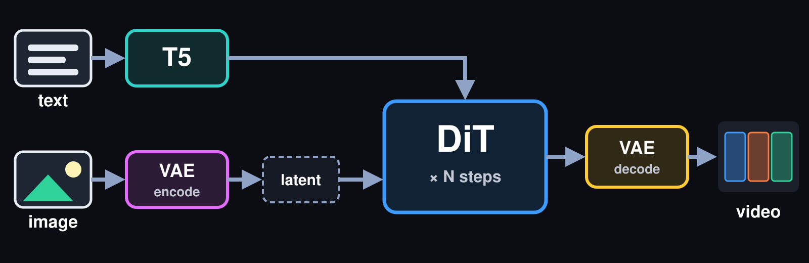
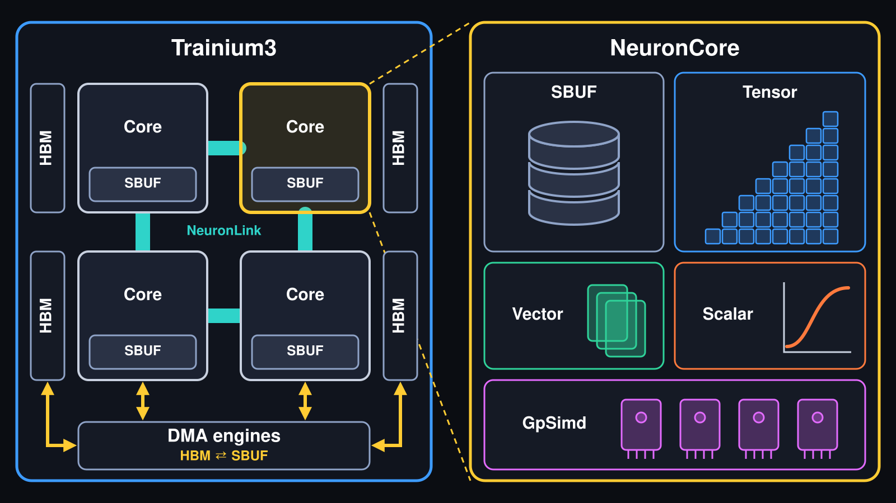
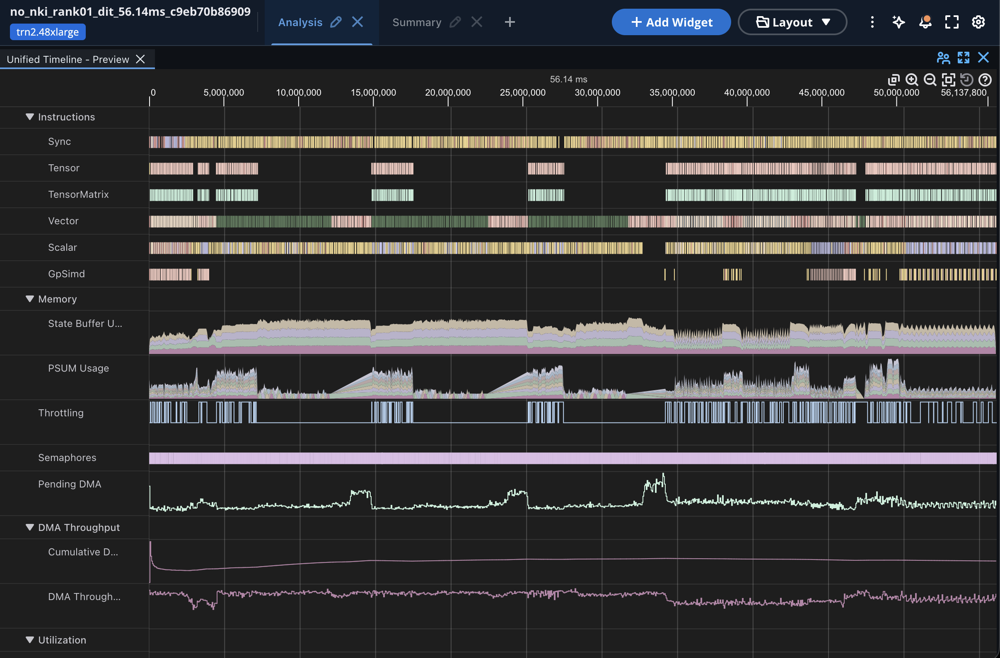
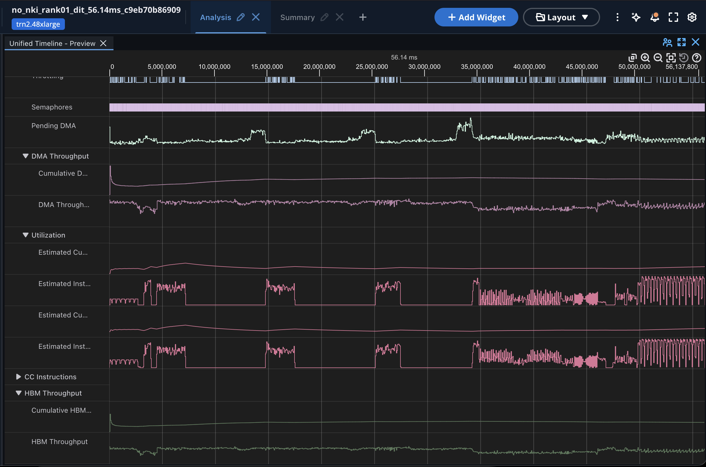
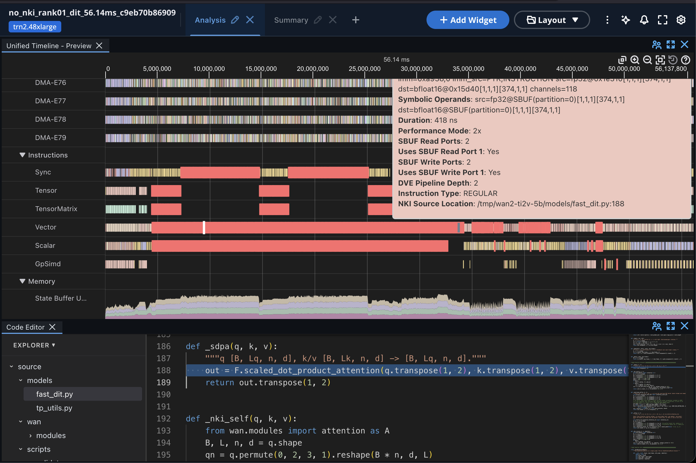
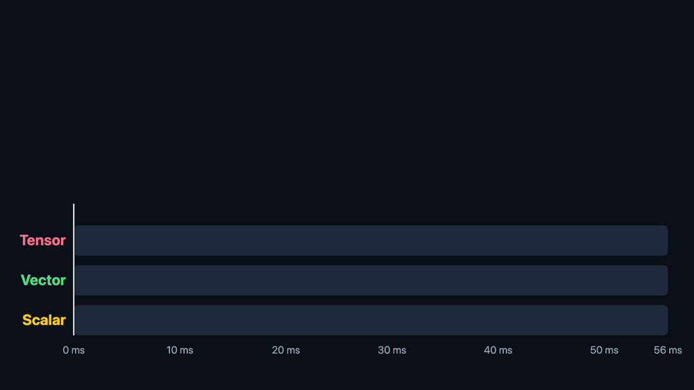
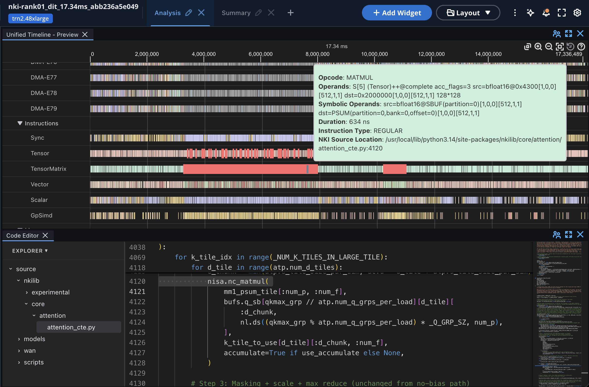

# Serving world models on AWS Trainium with native PyTorch

re:Invent code talk: outline, talking points and code to show.

> The next major leap in AI is predicting and interacting with the physical world. World models
> bridge digital reasoning with real-world execution, introducing new infrastructure demands for
> video generation, robotics, and gaming workloads. We'll explore the emerging architecture of
> world models and why AWS Trainium, purpose-built for better price-performance, is well suited
> to serve them. Learn how native PyTorch support with torch.compile fuses operations into
> optimized device graphs, and how NKI custom kernels accelerate critical operators like
> attention. You'll leave able to move world model inference from eager prototyping to compiled
> deployment using familiar PyTorch workflows.

**Worked example:** Wan2.2-TI2V-5B, a text + image to video model. One 704x544, 81-frame video,
10 denoising steps, on one Trainium2 device (8 NeuronCores). Numbers are from
[RESULTS.md](https://github.com/yahavb/wan2-ti2v-5b/blob/788674b/RESULTS.md). Code links are pinned to commit `788674b`.

**The arc:** eager prototype (76.6 s) → torch.compile (36.8 s) → NKI kernels → scale across
cores → serve it (8.7 s). Each stage uses PyTorch the way the audience already knows it.

---

## 1. From video diffusion to world models (~8 min)

### Slide: the pipeline we optimize, end to end



- **T5** encodes the prompt once per request.
- **DiT** (diffusion transformer, 14B) denoises the latent video chunk by chunk: 40 blocks, 7
  chunks of 3 latent frames, 4,320 tokens per chunk, attending a KV cache of up to 17,280 keys.
  Each chunk takes N = 4 denoise steps with no CFG, plus one forward that writes the chunk into
  the KV cache (skipped for the last chunk). That is 34 forwards, 1,360 block calls per video.
- **VAE** decodes 21 latent frames into 81 frames of video.

### Slide: a world model is this pipeline, extended in three ways
1. **Checkpoints trained to model the world.** Realistic dynamics, and conditioning on actions
   (move, turn, interact), not only on text.
2. **Autoregressive.** It is the same T5 → DiT → VAE, run chunk after chunk. The DiT keeps the
   KV cache from earlier chunks, so the scene stays consistent as the video goes on.
3. **Streaming.** The DiT hands each chunk of a few latent frames to the VAE as soon as it is
   ready. Pixels come out chunk by chunk while the DiT works on the next chunk. Sink and rolling
   caches bound the memory.

<!-- embed: anim/world_model_streaming.html -->

**Talking point:** "For the next 40 minutes we optimize the video diffusion pipeline: T5, DiT,
VAE. Everything carries over to a world model. At the end we come back to a real one."

### Slide: what this means for serving
1. **Long sequences.** Attention over thousands of tokens dominates compute.
2. **Many repeated calls.** The same block graph runs hundreds of times, so per-call overhead
   matters.
3. **Two different halves.** The DiT is a regular, matmul-heavy transformer. The VAE is a
   chain of convolutions whose shapes change from chunk to chunk.
4. **Latency per chunk.** In a world model, the user waits for each chunk, so time to the next
   frames is what counts.

### Slide (end of talk, callback): LingBot-World v2
- LingBot-World v2 ([`~/lingbot-world-v2`](https://technology.robbyant.com/lingbot-world-v2))
  is built on Wan2.2. It is the same T5 → DiT → VAE, but causal (autoregressive), conditioned
  on actions, with an unbounded horizon, and a distilled fast variant for real time.
- What carries over from this talk: block-compiled DiT graphs, NKI attention, collectives in
  the graph, and a VAE that decodes chunk by chunk with nkilib convs.
- What is new: a KV cache that lives across calls, and a DiT → VAE handoff per chunk.

## 2. Why Trainium for this workload (~5 min)

### Slide: the hardware
- One Trainium2 device exposes 8 NeuronCores in LNC1 mode.
- Each core has four engines that run at the same time: **Tensor** (matmuls), **Vector**
  (elementwise and reductions), **Scalar** (activations such as exp), **GpSimd** (general
  purpose), plus on-chip SBUF memory.
- The cores are linked for fast in-device collectives (all-reduce, all-gather,
  reduce-scatter). Tensor and sequence parallelism ride on these links.
- The whole pipeline (5B DiT, T5 and VAE) fits on one device's HBM.

### Slide: Trainium3, and one NeuronCore up close


Sources: [Trainium3](https://awsdocs-neuron.readthedocs-hosted.com/en/latest/about-neuron/arch/neuron-hardware/trainium3.html),
[NeuronCore-v2](https://awsdocs-neuron.readthedocs-hosted.com/en/latest/about-neuron/arch/neuron-hardware/neuron-core-v2.html).

### Slide: the software stack

<!-- embed: anim/trainium_collectives.html -->

<!-- embed: anim/neuron_sdk.html -->

_Price-performance: quote only the official AWS figures here. This talk doesn't measure cost._

---

## 3. The eager prototype (~7 min)

**Message:** start in eager mode. It runs the reference model with very few changes, and it
gives you a correct baseline.

Live code: move the model to the device.
[`inference_neuron_ti2v.py#L72`](https://github.com/yahavb/wan2-ti2v-5b/blob/788674b/inference_neuron_ti2v.py#L72),
[`#L194-L213`](https://github.com/yahavb/wan2-ti2v-5b/blob/788674b/inference_neuron_ti2v.py#L194-L213)

```python
NEURON_DEVICE = torch.device("neuron")
torch.neuron.set_device(local_rank)
text_encoder.model = text_encoder.model.to(NEURON_DEVICE)
vae.model = vae.model.to(device=NEURON_DEVICE, dtype=torch.bfloat16)
```

What we had to change in the reference code (keep this short; it is the honest list):
- No complex dtypes on the device. RoPE is rewritten with real cos and sin tables
  ([`rope_neuron.py`](https://github.com/yahavb/wan2-ti2v-5b/blob/788674b/rope_neuron.py)).
- No float64 on the device.

Baseline: **76.6 s** per video (DiT 44.3 s, VAE 32.3 s). The output is correct, and it is the
reference that every later step is checked against.

Talking point: get it correct in eager mode first, and save that output. Every later
optimization must reproduce it.

---

## 4. torch.compile fuses the model into device graphs (~12 min)

**Message:** torch.compile is where most of the speed comes from. What you put inside one
compiled graph matters as much as compiling at all.

### Slide: the first attempt, compiling pieces
The prototype compiled only small modules. The all-reduce after each tensor-parallel matmul was
kept outside the graph on purpose, so each block became many small graphs with Python in between.
[`models/tp_utils.py#L119-L128`](https://github.com/yahavb/wan2-ti2v-5b/blob/788674b/models/tp_utils.py#L119-L128)

```python
block.ffn = torch.compile(block.ffn, backend="neuron", dynamic=False)

@torch.compiler.disable          # forces a graph break around every collective
def all_reduce_sum(x): ...
```

### Slide: one graph per transformer block
[`models/fast_dit.py#L260-L311`](https://github.com/yahavb/wan2-ti2v-5b/blob/788674b/models/fast_dit.py#L260-L311),
[`#L586-L645`](https://github.com/yahavb/wan2-ti2v-5b/blob/788674b/models/fast_dit.py#L586-L645)

The FFN (feed-forward network) is the part of each transformer block that runs every token
through two large matmuls with an activation between them (here 3072 → 14336 → 3072), after
the attention layers.

```python
import torch.distributed._functional_collectives as funcol

def _all_reduce(x):
    return funcol.all_reduce(x, "sum", get_tp_group())   # traced: lives inside the graph

class _FastBlock(nn.Module):
    def forward(self, x, e, cos, sin, ck, cv):
        # norm + modulation, QKV, QK-norm, RoPE, attention, O-proj + all-reduce,
        # cross-attention, FFN + all-reduce, gated residuals: all in one graph
        ...

kw = dict(backend="neuron", dynamic=False, fullgraph=True)
self.blocks = [torch.compile(_FastBlock(b, ...), **kw) for b in model.blocks]
```

What the compiler does with that:
1. **Fusion.** Norms, modulation, RoPE and residual adds are fused with their neighbours,
   instead of a round trip to HBM for each op.
2. **One launch per block** instead of many, with no Python in between.
3. **Collectives scheduled by the compiler**, next to the matmul that produces them.
4. **One NEFF for all 30 blocks.** The weights are graph inputs, so one compile serves all
   600 block calls.
5. **`fullgraph=True` fails loudly** if anything would split the block.

<!-- embed: anim/op_fusion.html -->

Also: batch the two CFG passes into one call.

Result: DiT 4.4 → 1.91 s/step. Total **76.6 s → 36.8 s**.

**Demo idea:** the same block, eager vs compiled, in the Neuron Explorer system trace. Many
short executions with gaps become one long execution.

### Slide: compile best practice, roll the loop
Same decoder, same ops; only the scope handed to torch.compile changes. Measured 2026-11-05 on trn2 at 368x480x21.

| Scope | Compile, first run | Warm VAE decode |
|---|---|---|
| Unrolled: `torch.compile(decoder)`, one graph per latent frame | 58 min | 11.5-12.9 s |
| Rolled: `torch.compile` of one ResidualBlock body, reused | **~3 min** | **4.4 s** |

<!-- embed: anim/compile_rolled.html -->

Before, unrolled (commit `1b18e22`, trimmed): [`#L969-L984`](https://github.com/yahavb/wan2-ti2v-5b/blob/1b18e22/wan/modules/vae2_2.py#L969-L984), [`#L836-L847`](https://github.com/yahavb/wan2-ti2v-5b/blob/1b18e22/wan/modules/vae2_2.py#L836-L847)
```python
# animation: decoder = torch.compile(self.decoder)
decoder = torch.compile(self.decoder, backend="neuron", dynamic=False)
for i in range(iter_):                       # once per latent frame
    # animation: out = decoder(x)
    out_ = decoder(x[:, :, i:i + 1],
                   feat_cache=self._feat_map, feat_idx=self._conv_idx)

class Decoder3d(nn.Module):
    def forward(self, x, feat_cache=None, feat_idx=[0], first_chunk=False):
        # animation: for block in blocks  (traced: all 14 blocks go into ONE graph)
        for layer in self.middle:        # 2 ResidualBlocks (+ attention): blocks 1-2
            x = layer(x, feat_cache, feat_idx)
        for layer in self.upsamples:     # 4 stages, 3 ResidualBlocks each: blocks 3-14
            x = layer(x, feat_cache, feat_idx, first_chunk)
```
After, rolled (commit `0ae83b3`, trimmed): [`#L340`](https://github.com/yahavb/wan2-ti2v-5b/blob/0ae83b3/wan/modules/vae2_2.py#L340), [`#L895-L905`](https://github.com/yahavb/wan2-ti2v-5b/blob/0ae83b3/wan/modules/vae2_2.py#L895-L905), [`#L366-L376`](https://github.com/yahavb/wan2-ti2v-5b/blob/0ae83b3/wan/modules/vae2_2.py#L366-L376)
```python
# animation: G = torch.compile(block_body)
_rolled_res_compiled = torch.compile(_rolled_res_unit, backend="neuron", dynamic=False)

class Decoder3d(nn.Module):
    def forward(self, x, feat_cache=None, feat_idx=[0], first_chunk=False):
        # animation: for block in blocks  (unchanged, plain Python, NOT compiled)
        for layer in self.middle: ...    # blocks 1-2
        for layer in self.upsamples: ... # blocks 3-14

class ResidualBlock(nn.Module):
    def forward(self, x, feat_cache=None, feat_idx=[0]):
        # animation: x = G(x, cache, block.weights)
        out, n1, n2 = _rolled_res(x, feat_cache[i], feat_cache[i + 1],   # calls G
                                  r[0].gamma, r[2].weight, r[2].bias, ...)
```
Talking point: map the code to the animation. Before, `torch.compile` wraps the decoder, so the
compiler traces its loops and builds all 14 blocks into one graph. After, it wraps one block body (G),
and each block calls G with its own weights. Same ops, same output (CPU check: exact match).

### Slide: LingBot-World v2, the VAE won by compiling whole blocks
LingBot's upstream decoder split the latent width over 64 ranks
and ran each latent frame as ~33 single-conv graphs, ~200 eager ops and 33 host-issued halo
all-gathers: ~2.95 s for ~0.2 s of convolution. Here one compiled graph per decoder block, with
the halo exchange as functional collectives inside it, beat per-op execution.
[`wan/modules/vae2_1_fused.py#L245-L252`](https://github.com/yahavb/lingbot-world-v2/blob/a12e766/wan/modules/vae2_1_fused.py#L245-L252),
[`#L314-L315`](https://github.com/yahavb/lingbot-world-v2/blob/a12e766/wan/modules/vae2_1_fused.py#L314-L315)

```python
def _res_unit(x, c1, c2, g1, s1, w1, b1, g2, s2, w2, b2, wsc, bsc, sel):
    y = F.silu(_rms(x, g1, s1)).to(w1.dtype)
    y, c1 = _cconv(_halo(y, sel), c1, w1, b1)     # halo exchange = functional collectives
    ...
torch.compile(fn, backend="neuron", dynamic=False, fullgraph=True)   # one graph per block
```

| Step (64 ranks, trn2) | VAE time | Video vs fp32 decode |
|---|---|---|
| Upstream per-conv decoder | 3.01 s | 43.5 dB |
| Whole blocks compiled, halos in the graphs | 1.36 s | within 1.8e-5 of per-conv |
| bf16 convolutions (norms, softmax, output conv in fp32) | 0.80 s | 56.6 dB |
| Compiler `-O1`, norm sums as a matmul | 0.55 s | 56.6 dB |
| 2-D height x width tiles instead of width slices | 0.33 s | 56.55 dB |
| 6 latent frames per step | **0.31 s** | 56.57 dB |

- **Norm as a matmul:** the channel sum of squares as one fp32 matmul against a ones vector. The
  default form cost ~174 ms of Tensor time and 64 ms of GpSimd cross-lane reduce
  ([`#L214-L229`](https://github.com/yahavb/lingbot-world-v2/blob/a12e766/wan/modules/vae2_1_fused.py#L214-L229)).
- **The 2-D tiles also fixed a quality bug:** width slices padded the 96-wide latent to 128 by
  repeating its last column, which leaked into real pixels (43.5 dB). Tiles need no padding.
- **Did not help:** skipping the halos entirely (a diagnostic) was slower, 0.95 s, so halos were
  not the cost; 1 / 4 / 10 / 20 frames per step gave 1.35 / 1.19 / 1.21 / 1.93 s.

### Slide: you compiled it, and it is still slow. Now what?
You did the compile work: one graph per block, rolled loops, fused ops. The DiT is at 1.90 s/step.
But compiling only decides what goes into one graph. It does not promise that the graph keeps the
engines busy. If it is still slow after compiling, the answer is inside the graph, and only a
device profile shows it. So before writing any kernel, profile the compiled block.

The stage: one DiT block compiled as one graph (`fullgraph=True`) with native SDPA attention and
no NKI. One core, one production rank's shard: 3 heads x 2 CFG passes x 7,854 tokens. The
pipeline at this stage takes 21.9 s (1.90 s/step).

Profile: `1_compiled_no_nki/pairs/rank01_dit_56.14ms_c9eb70b86909` (`.neff` + `.ntff`), with
`1_compiled_no_nki/source.tar.gz` uploaded as the source. Job:
[`wan2-ti2v-5b-tp8-nonki-job.yaml`](https://github.com/yahavb/wan2-ti2v-5b/blob/main/wan2-ti2v-5b-tp8-nonki-job.yaml),
script: [`scripts/prof/block_pair.py`](https://github.com/yahavb/wan2-ti2v-5b/blob/main/scripts/prof/block_pair.py).



What the timeline shows (block = 56.1 ms):
1. **The Tensor row has three long gaps:** about 7-15 ms, 18-25 ms and 28-34 ms. That's about
   21 ms of a 56 ms block, nearly 40%, with the matmul engine doing nothing.
2. **During those gaps, Vector shows long dark-green bars and Scalar stays busy.** That is the
   softmax of native SDPA (`fast_dit.py:188`). Vector computes the row max and row sum, and
   Scalar computes the exp. The "Estimated Inst" utilization drops to zero in exactly those three
   windows:

   
3. **Each Tensor burst after a gap** is P×V. It waits for the whole softmax. The Pending DMA
   spikes just before each burst are the softmax output loading back from memory.
4. **The pattern repeats three times,** once for each of the 3 attention heads on this core.
5. **From about 34 ms on, Tensor is dense:** output projection, cross-attention and FFN. That
   part is fine.

Selecting the source line `fast_dit.py:188` (`F.scaled_dot_product_attention`) in the Code
Editor highlights every instruction it produced (red). Vector and Scalar are red almost without
a break from about 5 ms to 33 ms: that is the softmax. Tensor is red only in short bursts, the
Q×K and P×V matmuls, with gaps between them.



The same thing, simplified:



(Live version: [`anim/sdpa_softmax_engines.html`](anim/sdpa_softmax_engines.html).)

Measured on the instruction table (`engine_overlap.py`):

| | Native SDPA block |
|---|---|
| Block time | 56.1 ms |
| Every engine idle | 16% |
| Only one engine busy | 36% |
| Tensor busy | 39% |
| Softmax max and sum (Vector) | 12.8 ms |
| Softmax exp (Scalar) | 7.7 ms |

**Transition:** "The compiler runs attention as matmul, then the whole softmax, then matmul, so
the engines take turns. Attention is now the bottleneck, and that is where a custom kernel pays
off."

---

## 5. NKI custom kernels for the critical operators (~12 min)

**Message:** when one operator dominates and the compiler's version is not good enough, write
or reuse an NKI kernel and call it from PyTorch. This works in eager mode and inside a
compiled graph.

### Slide: what NKI is, in one slide
- Neuron Kernel Interface: Python kernels that control the tiling, the on-chip memory (SBUF)
  and which engine does what.
- nkilib ships production kernels, such as `attention_cte` and `conv3d`, that you can use
  directly.
- `wrap_nki` makes a kernel a regular torch call.

### Slide: attention, the operator that dominates
At 7,854 tokens, self-attention through the default SDPA path took 18.2 ms per call.

**Kernel 1, const-max softmax (5.8 ms per call).** It subtracts a known bound instead of
tracking a running max. That is only exact when scores stay under the bound, and on all layers
the video broke after frame 0. The fix was to compute each layer's worst-case score from its
QK-norm weights and use the kernel only where it is safe (22 of 30 layers).
[`models/fast_dit.py#L77-L84`](https://github.com/yahavb/wan2-ti2v-5b/blob/788674b/models/fast_dit.py#L77-L84)

```python
def const_max_layer_ok(block):
    gq = sa.norm_q.weight.abs().reshape(-1, d).amax(1)
    gk = sa.norm_k.weight.abs().reshape(-1, d).amax(1)
    hard = float((d ** 0.5) * (gq * gk).max())   # worst-case scaled score
    return hard <= CONST_MAX_HARD_LIMIT, hard
```
DiT 1.92 → 1.19 s/step.

**Kernel 2, nkilib `attention_cte` (5.3 ms per call).** It is exact flash attention with no
bound, so it is safe on every layer. It runs inside the compiled block graph.
[`models/fast_dit.py#L228-L241`](https://github.com/yahavb/wan2-ti2v-5b/blob/788674b/models/fast_dit.py#L228-L241)

```python
from nkilib.core.attention.attention_cte import attention_cte

def _cte(q, k, v):
    qn = q.permute(0, 2, 1, 3).reshape(B * n, Lq, d)
    kn = k.permute(0, 2, 3, 1).reshape(B * n, d, Lk)
    vn = v.permute(0, 2, 1, 3).reshape(B * n, Lk, d)
    return attention_cte(qn, kn, vn, scale=d ** -0.5, causal_mask=False)
```
Self- and cross-attention: total 16.2 → 13.2 s.

Talking points:
- Validate a numerical shortcut on real activations, not on random inputs.
- Kernel limits are real. Calling const-max on all heads at once overflowed SBUF and crashed
  the compiler, so it is called on as many heads as fit.

### Slide: the same approach for the VAE convolutions
nkilib `conv3d`, called from the eager VAE, with a gate that decides when it beats the
default.
[`kernels/vae_conv3d.py#L33-L58`](https://github.com/yahavb/wan2-ti2v-5b/blob/788674b/kernels/vae_conv3d.py#L33-L58)

```python
@nki.jit
def _conv3d_3x3x3_kernel(x, filters, bias):
    return conv3d(x, filters, bias, stride=(1, 1, 1), padding=PADDING, dilation=(1, 1, 1))

_conv3d_3x3x3 = wrap_nki(_conv3d_3x3x3_kernel)
```
Then fuse into the kernel: the residual add (`residual_add_loc=POST_ACT`), and an upsample
followed by a conv done as four 2x2 convs on the low-res input (2.25x fewer MACs). VAE 6.0 →
2.6 s.

### Slide: the kernels in the profiler, DiT and VAE
The same block, same shard, same core, with nkilib `attention_cte` for self- and
cross-attention. The pipeline in this configuration takes 9.7 s on the Kubernetes job (8.7 s in
RESULTS.md from a Docker run).

Profile: `2_kernels/pairs/rank01_dit_17.34ms_abb236a5e049`, with `2_kernels/source.tar.gz` as
the source (it includes nkilib's `attention_cte.py` and `conv3d.py`). Job:
[`wan2-ti2v-5b-tp8-job.yaml`](https://github.com/yahavb/wan2-ti2v-5b/blob/main/wan2-ti2v-5b-tp8-job.yaml).



What the timeline shows (block = 17.3 ms):
1. **Self-attention runs from about 3.3 to 8.0 ms** (the long red bar on TensorMatrix): about
   5 ms for all three heads, against about 32 ms with native SDPA.
2. **The Tensor row has no gaps in that window,** and Vector and Scalar are busy in the same
   window. The softmax runs at the same time as the matmuls instead of between them.
3. **The selected instruction is `attention_cte.py:4120`:** `nc_matmul` of a Q tile with one K
   tile (Q×K), inside `for k_tile_idx in range(...)`. The next step in the kernel is "Masking +
   scale + max reduce" on Vector, which runs while Tensor moves on to the next K tile.
4. **The short red bar at about 10.2-11.0 ms is cross-attention,** also `attention_cte`, under
   1 ms.
5. **Everything else is the QKV, output projection and FFN matmuls,** dense on Tensor.

| | Native SDPA | `attention_cte` |
|---|---|---|
| Block time | 56.1 ms | 17.3 ms |
| Self-attention | ~32 ms | ~5 ms |
| Every engine idle | 16% | 1.1% |
| 3+ engines busy | 16% | 34% |
| Tensor busy | 39% | 79% |

**VAE:** `2_kernels/pairs/rank03_vae_7.51ms_85b7d56324c0` is the heaviest VAE graph, nkilib
`conv3d` (`conv3d.py:3459`). Tensor is busy 98% of the time at 95% of peak, and 3+ engines are
busy 80% of the time.

**Talking point:** "Same block, same shape, same core. The kernel splits the keys into tiles,
so Tensor computes Q×K for the next tile while Vector and Scalar finish the softmax of this one.
Attention goes from about 32 ms to about 5 ms, and the block from 56 ms to 17 ms."

**Caveat to say once:** these block profiles run one block on one core with no collectives,
because the real block graph contains collectives and can't be replayed on its own. The work per
core is the same as in production.


### Slide: LingBot-World v2, attention over KV chunks
In a world model the DiT attends a list of cached chunks (a sink plus a rolling window, up to
17,280 keys), and under CP16 each rank holds only 270 query tokens. The kernel was fine; what
surrounded it was not.
- **The upstream path copied every chunk into one zero-filled, 512-aligned buffer** before each
  `attention_cte` call: 1.7 ms of a 10.4 ms block (2 devices), and 3.1 s per forward for the
  second chunk at CP16.
- **It was also wrong:** no bounds were passed, so the zero keys entered every softmax
  denominator (flat heads scaled by 0.993, by 0.939 in the first chunk).

<!-- embed: anim/cte_merge.html -->

Before, `_cte_attention_chunks` (trimmed): [`attention.py#L436-L455`](https://github.com/yahavb/lingbot-world-v2/blob/a12e766/wan/modules/attention.py#L436-L455)
```python
# animation: new buffer (HBM), zero-filled, padded up to the tile edge
lkv_p = lkv + (KV_ALIGN - lkv % KV_ALIGN) % KV_ALIGN
k_c = q.new_zeros((n, lkv_p, d), dtype=dtype)
v_c = q.new_zeros((n, lkv_p, d), dtype=dtype)

# animation: copy sink, chunk 1, 2, 3 into it -- on every attention call
off = 0
for kc, vc in zip(k_chunks, v_chunks):
    L = int(kc.shape[1])
    k_c[:, off:off + L] = kc[0].permute(1, 0, 2).to(dtype)
    v_c[:, off:off + L] = vc[0].permute(1, 0, 2).to(dtype)
    off += L

# animation: ONE attention_cte call over the whole buffer -> out
out = _attention_cte(q_c, k_c, v_c, scale=1.0, causal_mask=False,
                     tp_q=True, tp_k=True, tp_out=False)
```
After, `_cte_attention_chunks_merged` (`LINGBOT_CTE_MERGE=1`, trimmed): [`attention.py#L652-L682`](https://github.com/yahavb/lingbot-world-v2/blob/a12e766/wan/modules/attention.py#L652-L682)
```python
# animation: for chunk in KV cache (HBM) -- one call per chunk, read in place
for kc, vc in zip(k_chunks, v_chunks):
    o, neg_max, s = _attention_cte(q_c, kc, vc, scale=1.0, causal_mask=False, ...,
                                   cache_softmax=True, skip_output_normalization=True)
    outs.append(o)                    # animation: partial (unnormalized output)
    maxs.append(-neg_max.float())     #   + its row max
    sums.append(s.float())            #   + its row sum

# animation: merge -- rescale each partial by the max, add up, divide (exact)
m_all = maxs[0]
for m in maxs[1:]:
    m_all = torch.maximum(m_all, m)
w = [torch.exp(m - m_all) for m in maxs]
out = sum(wc * o for wc, o in zip(w, outs)) / sum(wc * sc for wc, sc in zip(w, sums))
```

The kernel returns the unnormalized output with its row max and sum; the chunks merge in fp32.
Gain 1.0000 on every head. With sequence parallelism: GEN 8.95 → 5.73 s.

**Then fewer, fuller calls** (`LINGBOT_ATTN_PAIR=1`). Each extra call costs ~0.15 ms whatever its
size, so two chunks go into one call, the first as the kernel's prefix-cache prior. That is the
same softmax over their union, so it is exact. Block 3.28 → 2.88 ms, GEN 4.88 → 4.48 s.
[`wan/modules/model_fast.py#L1052-L1077`](https://github.com/yahavb/lingbot-world-v2/blob/a12e766/wan/modules/model_fast.py#L1052-L1077)

### Slide: LingBot-World v2, tune the vendored kernel
nkilib `attention_cte` copied into the repo
([`kernels/attention_cte_lb.py`](https://github.com/yahavb/lingbot-world-v2/blob/a12e766/kernels/attention_cte_lb.py)), every change marked `lingbot:`
behind its own flag, and checked bitwise against nkilib at every DiT call shape
([`perf/attn_bitcmp.py`](https://github.com/yahavb/lingbot-world-v2/blob/a12e766/kiro/attn_bitcmp.py)).
1. **V tiles 8 per DMA** (`LINGBOT_CTE_VGROUP=8`). Each software-DGE `dma_copy` costs ~0.75 µs of
   GpSimd time whatever its size, and there were ~800 per call. GEN 3.94 → 3.74 s.
   [`#L172-L177`](https://github.com/yahavb/lingbot-world-v2/blob/a12e766/kernels/attention_cte_lb.py#L172-L177)
2. **K read in the layout the CP all-gather leaves it** (`LINGBOT_K_BLOCKED=1`), no permute, plus a
   dead cache write skipped. GEN 3.74 → 3.66 s.
3. **Cross-attention cache stored in the kernel's layout:** two strided transposes gone, ~250 µs
   of a 3.2 ms block.

Did not work: runtime-built DMA descriptors (faster per block, but rebuilt whenever the 40 blocks
bind different buffers: GEN 4.26 vs 3.94 s); K+V double buffering (does not fit SBUF); one call
over all 17,280 keys (0.72 vs 0.68 ms).

Where the time is now, one block (2.53–2.60 ms, TP4 x CP16): ~350 µs of all engines idle waiting
for the K/V all-gathers, ~100 µs of K/V loads at the start of each call, ~150 µs merging (almost
all data layout), FFN ~310 µs.

**Talking point:** "Most of the attention win was not new math. It was fewer kernel calls, fewer
DMAs per call, and no copies around the kernel. The profiler showed which one each time."

**Correctness:** only DMAs changed, yet some ranks move by up to 6.2e-3 (output RMS 0.515): one
fp32 ulp in the row sum. An autoregressive rollout amplifies any rounding change, so the gate is
chunk 0 against fp32 (0.0125, upstream 0.0257), determinism, and the video.

---

## 6. Scale across the cores with torch.distributed (~6 min)

<!-- embed: anim/tp_then_cp.html -->

---

## 7. From benchmark to serving (~8 min)

**Message:** the compiled model is only useful if the server starts warm, keeps the device
fed, and is deployed like any other pod.

### Slide: the server
[`serve_ti2v.py`](https://github.com/yahavb/wan2-ti2v-5b/blob/main/serve_ti2v.py) serves the
same compiled pipeline the benchmark measures. It runs FastAPI on rank 0 (`POST /generate`,
`/health`, `/readiness`), with all 8 ranks in one torchrun.
- **Fixed shape.** Every request image is resized and cropped to the warm-up size, so no
  request triggers a compile.
- **Collectives stay on one thread.** They must run on the thread that compiled the graphs, so
  HTTP requests go on a queue and the main thread runs them.
- **T5 on the CPU, with a prompt cache.** It is needed for every request, and it does not fit
  in HBM next to the DiT and VAE.
- **Health before readiness.** `/health` answers while the model loads. `/readiness` turns true
  only after warm-up.

### Slide: warm-up is part of deployment
A lesson from this week: one warm-up run was not enough. On the current image, the second run
still traced NKI kernels. The VAE took 186 s, then 21 s, then 3.6 s. Warm up until the
timing settles before reporting ready (the server does 3 runs, `WARMUP_RUNS`).

### Slide: keep the device fed
Fixes found as gaps in the system trace:
- UniPC scheduler step on the device instead of a round trip to the CPU each step (device busy
  96.9% → 99.5%)
  ([`device_unipc.py`](https://github.com/yahavb/wan2-ti2v-5b/blob/788674b/models/device_unipc.py)).
- Encode the mp4 while the VAE is still decoding, instead of after it.
- Start ffmpeg with vfork: forking a process with tens of GB of memory stalled the runtime for
  90 ms.

### Slide: deploy on EKS
[`wan2-ti2v-5b-deploy.yaml`](https://github.com/yahavb/wan2-ti2v-5b/blob/788674b/wan2-ti2v-5b-deploy.yaml):
a resource claim for the NeuronCores, model weights cached on a PVC, and readiness and
liveness probes.


### Slide: LingBot-World v2, a live stream
Three deployments: the web page, DiT + T5 on half a trn3 (32 ranks, TP4 x CP8, ~0.58 s per
chunk), and the fused VAE, streaming each decode step's frames as soon as they are ready
([`lbw-v2-streaming-flow.html`](https://github.com/yahavb/lingbot-world-v2/blob/a12e766/lbw-v2-streaming-flow.html)). Lessons: read the VAE stream in
64 KB pieces (512 B reads starved rank 0's issue thread: 0.53 → 1.04 s per chunk); cache T5 by
prompt and pad on the host; warm up with a second, steered session. Measured: 17.3 fps, ~1.07 s
median from key press to new frames.

---

## 8. Did it stay correct, and where did the time go (~5 min)

**Validate every step against the eager reference**
([`scripts/validate/validate_job.sh`](https://github.com/yahavb/wan2-ti2v-5b/blob/788674b/scripts/validate/validate_job.sh)):
- Byte-identical output with the new flags off, and identical output across repeated runs.
- Step-0 noise prediction against an fp32 CPU run: within the bf16 floor.
- VAE against an exact fp32 decode: 44.6 dB.

**Profile with Neuron Explorer:** a system trace on every rank shows host gaps, and a device
trace on one rank shows the engines, linked back to the source.

The journey:

| Stage | Total |
|---|---|
| Eager prototype | 76.6 s |
| + torch.compile, one graph per block | 36.8 s |
| + VAE tiled over 8 cores, NKI conv kernels | 16.1 s |
| + NKI attention, CFG-parallel, sequence parallel | 10.8 s |
| + VAE fusion, host fixes | **8.7 s** |

For reference, an A100 with torch.compile takes 16.92 s for the same video.


LingBot-World v2, 81 frames 480x768, 16 trn2 devices:

| Stage | GEN | VAE | Total | fps |
|---|---|---|---|---|
| Upstream port, TP8 x CP8 | 8.95 s | 2.95 s | 11.90 s | 6.81 |
| + merged attention, SP, FiLM all-to-all | 5.75 s | 3.01 s | 8.75 s | 9.26 |
| + VAE fused and bf16, paired KV chunks | 4.48 s | 0.81 s | 5.29 s | 15.32 |
| + host fixes, VAE `-O1` and 2-D tiles | 4.04 s | 0.33 s | 4.37 s | 18.55 |
| + vendored kernel: grouped V loads, rank-blocked K | **3.66 s** | **0.31 s** | **3.97 s** | **20.43** |

---

## 9. Takeaways (~2 min)

1. Start in eager mode on the `neuron` device. It gives you a correct baseline with minimal
   changes.
2. Compile with `torch.compile(backend="neuron")`, and choose the scope: one graph per repeated
   block, with the collectives inside it.
3. Where one operator dominates, use an NKI kernel from PyTorch. Check its numerics on real
   data.
4. Scale with plain `torch.distributed` and functional collectives.
5. Serve warm: warm up until the timing settles, gate readiness on it, and keep the host out of
   the way.

---

## Open items

- Add an Explorer screenshot of the VAE `conv3d` pair (`2_kernels/pairs/rank03_vae_7.51ms_85b7d56324c0`).
- Deploy the ported server (`wan2-ti2v-5b-deploy.yaml`) and record time per request.
- Confirm which node the 7.1 s validation run used (trn2 or trn3-dev1). This outline uses only
  trn2 numbers.
- Get the official Trainium price-performance wording.
